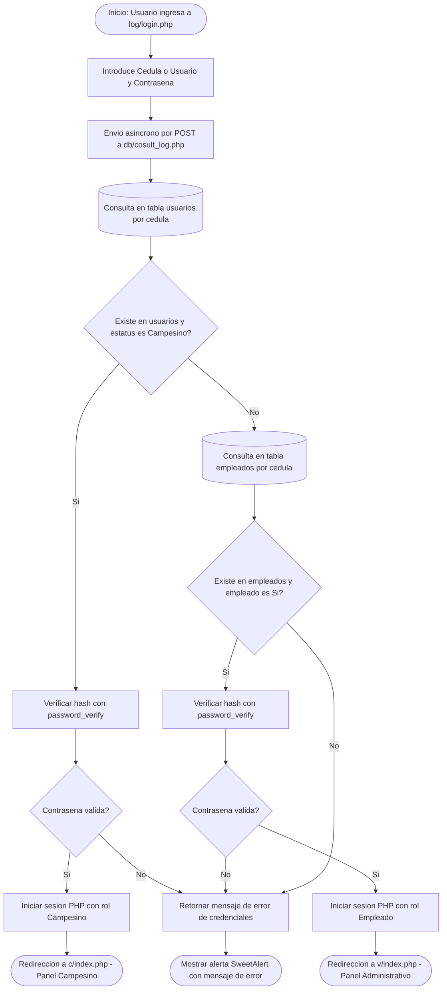
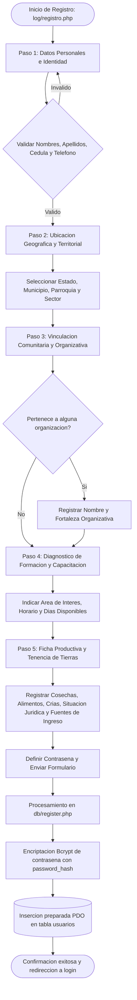
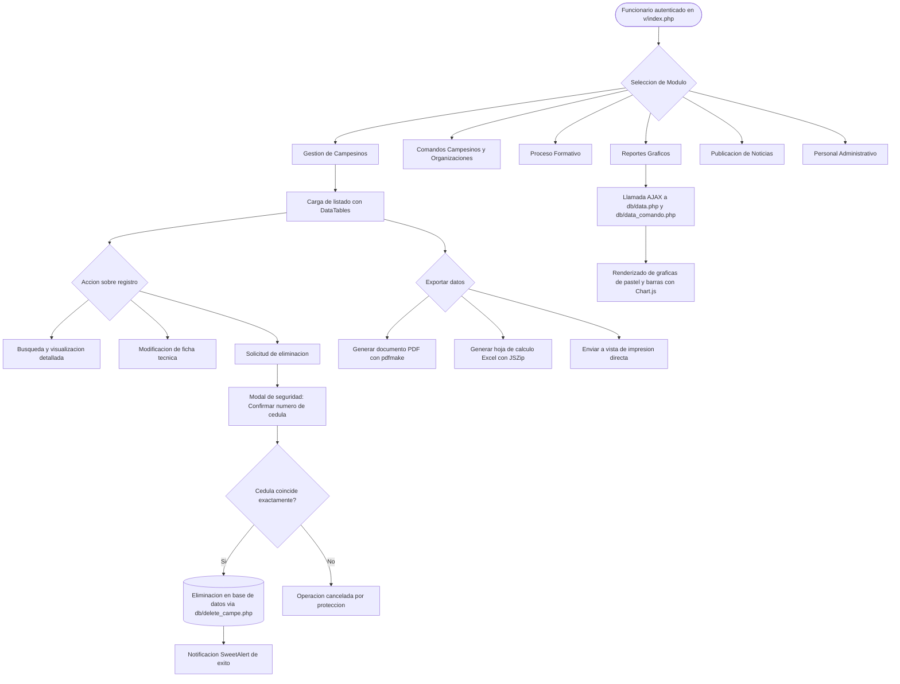
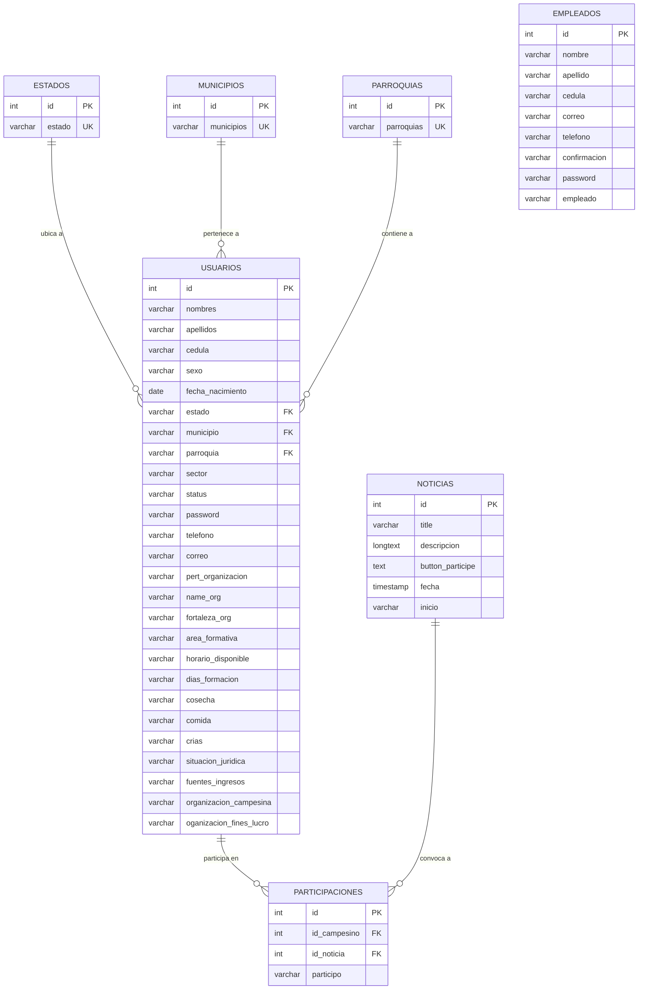

# Sistema de Informacion y Gestion Territorial - INTI

## Descripcion General
Este proyecto es una plataforma web desarrollada para el Instituto Nacional de Tierras (INTI). Su proposito fundamental es centralizar, organizar y facilitar el registro y seguimiento de los campesinos, productores agricolas, organizaciones agrarias y el personal administrativo de la institucion.

A traves de la plataforma, los funcionarios pueden gestionar censos campesinos, supervisar procesos de formacion y capacitacion, analizar datos estadisticos mediante indicadores graficos y publicar novedades o comunicados institucionales. Al mismo tiempo, los campesinos cuentan con un espacio individual donde consultar su ficha de registro y enterarse de las actividades y noticias pertinentes.

---

## Estructura y Arquitectura del Sistema
El aplicativo esta disenado bajo una estructura modular en PHP, con separacion clara entre la persistencia de datos, la logica de control y las interfaces de usuario.

* index.php: Enrutador de entrada al sistema que redirecciona al usuario al inicio de sesion.
* db/: Capa de conexion a la base de datos mediante PHP Data Objects (PDO) y operaciones CRUD (creacion, consulta, actualizacion y eliminacion), junto con endpoints que suministran datos en formato JSON para las graficas.
* log/: Modulo de acceso publico. Incluye el formulario de inicio de sesion (login), el registro guiado paso a paso para nuevos productores con seleccion territorial y las validaciones de entrada en el cliente.
* c/: Panel de control y vista del perfil para usuarios con estatus de Campesino.
* v/: Panel administrativo para funcionarios y personal del INTI. Contiene los listados maestros con DataTables, herramientas de busqueda en tiempo real, generadores de reportes, creacion de noticias y paneles con graficas.
* inicio/: Recursos visuales compartidos de la plantilla administrativa SB Admin 2 (estilos CSS, scripts JS, iconos y tipografias).
* assets/, css/, js/, fonts/: Librerias de terceros, plugins auxiliares y hojas de estilo complementarias.
* inti.sql: Volcado de la estructura de la base de datos relacional y datos base territoriales de Venezuela.

---

## Tecnologias y Herramientas Empleadas

### Backend
* PHP (version 8.x / 7.4+): Lenguaje principal del servidor, implementando PDO para consultas SQL preparadas y el algoritmo Bcrypt (password_hash y password_verify) para la proteccion de credenciales.
* MySQL / MariaDB (version 10.4+): Motor de base de datos relacional.

### Frontend
* HTML5: Marcado semantico para formularios y estructuras modales.
* CSS3 / SCSS: Hojas de estilo personalizadas y reglas de adaptabilidad.
* Bootstrap (v4 y componentes v5): Sistema de grillas, diseno responsivo y componentes de interfaz.
* SB Admin 2: Plantilla base de panel de administracion.
* JavaScript (ES6) y jQuery (v3.x): Control de eventos, peticiones asincronas mediante AJAX y validaciones en tiempo real en los campos de formulario.

### Librerias y Plugins Auxiliares
* DataTables: Tablas interactivas con paginacion, ordenamiento y buscador instantaneo.
* Extensiones DataTables (JSZip, pdfmake, vfs_fonts): Exportacion directa de registros a formatos Excel, PDF e impresion en navegador.
* Chart.js: Renderizado de graficos estadisticos (graficos circulares y de distribucion).
* SweetAlert / SweetAlert2: Ventanas modales y cuadros de confirmacion interactivos.
* Select2: Listas desplegables con filtrado dinamico.
* GSDK Bootstrap Wizard: Formularios de registro interactivos en varios pasos.
* FontAwesome y Material Design Iconic Font: Paquetes de iconos de interfaz.

---

## Diagramas de Flujo del Sistema

### 1. Flujo de Autenticacion y Control de Acceso por Rol
Este diagrama describe el ciclo de verificacion de credenciales al iniciar sesion, validando en primera instancia la coleccion de productores campesinos y posteriormente la de empleados administrativos institucionales.

---

### 2. Flujo del Asistente de Registro de Productores Campesinos (Wizard)
El registro publico de nuevos productores se gestiona mediante un asistente guiado de 5 etapas para asegurar la completitud de la ficha tecnica y territorial.

---

### 3. Flujo del Modulo de Gestion Administrativa
Describe las operaciones que realiza el personal del INTI para auditar, consultar y actualizar los registros agrarios con controles de confirmacion sensible.

---

## Diagrama Entidad-Relacion (ERD)

A continuacion se presenta el modelo relacional implementado en la base de datos `inti`:

---

## Diccionario de Datos

### Tabla: `usuarios`
Almacena la informacion integral de los productores agricolas y campesinos registrados en el censo del sistema.

| Nombre de Campo | Tipo de Dato | Nulo / Clave | Valor Predeterminado | Descripcion y Proposito |
| :--- | :--- | :--- | :--- | :--- |
| `id` | INT(11) | NOT NULL, PK | Auto-incremental | Identificador unico correlativo del usuario campesino. |
| `nombres` | VARCHAR(255) | NOT NULL | Ninguno | Nombres del campesino. |
| `apellidos` | VARCHAR(255) | NOT NULL | Ninguno | Apellidos del campesino. |
| `cedula` | VARCHAR(11) | NOT NULL | 'Sin Cedula' | Documento de identidad nacional para identificacion y acceso. |
| `sexo` | VARCHAR(6) | NOT NULL | Ninguno | Sexo o genero del campesino ('Hombre', 'Mujer'). |
| `fecha_nacimiento` | DATE | NOT NULL | Ninguno | Fecha de nacimiento para calculo de rangos etarios y censos. |
| `estado` | VARCHAR(255) | NOT NULL, FK | Ninguno | Nombre del estado federativo donde reside la unidad productiva. |
| `municipio` | VARCHAR(255) | NOT NULL, FK | Ninguno | Municipio correspondiente a la ubicacion del productor. |
| `parroquia` | VARCHAR(255) | NOT NULL, FK | Ninguno | Parroquia asignada segun division territorial. |
| `sector` | VARCHAR(255) | NOT NULL | Ninguno | Comunidad, caserio o sector especifico de residencia. |
| `status` | VARCHAR(100) | NOT NULL | 'Campesino' | Rol asignado en la plataforma ('Campesino'). |
| `password` | VARCHAR(100) | NOT NULL | Ninguno | Hash criptografico de la contrasena protegido con Bcrypt. |
| `telefono` | VARCHAR(255) | NOT NULL | Ninguno | Numero telefonico de contacto del productor. |
| `correo` | VARCHAR(255) | NOT NULL | Ninguno | Direccion de correo electronico para contacto institucional. |
| `pert_organizacion` | VARCHAR(255) | NOT NULL | Ninguno | Indicador afirmativo o negativo de membresia a un colectivo agrario. |
| `name_org` | VARCHAR(255) | NOT NULL | Ninguno | Nombre formal de la organizacion o asociacion campesina. |
| `fortaleza_org` | VARCHAR(255) | NOT NULL | Ninguno | Capacidad tecnica, productiva o logistica de su agrupacion. |
| `area_formativa` | VARCHAR(255) | NOT NULL | Ninguno | Rama tecnica o agroproductiva solicitada para formacion. |
| `horario_disponible`| VARCHAR(255) | NOT NULL | Ninguno | Jornada o bloque horario libre para talleres de capacitacion. |
| `dias_formacion` | VARCHAR(255) | NOT NULL | Ninguno | Dias habiles o fines de semana disponibles para formacion. |
| `cosecha` | VARCHAR(255) | NOT NULL | Ninguno | Tipologia de cultivos principales (hortalizas, cereales, tuberculos). |
| `comida` | VARCHAR(255) | NOT NULL | Ninguno | Destino o tipo de rubros orientados a la seguridad alimentaria. |
| `crias` | VARCHAR(255) | NOT NULL | Ninguno | Tipologia de produccion pecuaria (bovino, porcino, ovino, avicola). |
| `situacion_juridica`| VARCHAR(255) | NOT NULL | Ninguno | Condicion legal del predio ('Propio', 'Arrendado', 'Pisatario', etc.). |
| `fuentes_ingresos` | VARCHAR(255) | NOT NULL | Ninguno | Modalidad de sustento ('Venta Directa', 'Cooperativa', 'Intercambio'). |
| `organizacion_campesina` | VARCHAR(255) | NOT NULL | Ninguno | Clasificacion de comando agrario o colectivo comunitario. |
| `oganizacion_fines_lucro`| VARCHAR(255) | NOT NULL | Ninguno | Naturaleza economica de la asociacion a la que se vincula. |

---

### Tabla: `empleados`
Registra al personal oficial, analistas y administradores del INTI facultados para gestionar el panel de control.

| Nombre de Campo | Tipo de Dato | Nulo / Clave | Valor Predeterminado | Descripcion y Proposito |
| :--- | :--- | :--- | :--- | :--- |
| `id` | INT(11) | NOT NULL, PK | Auto-incremental | Identificador unico correlativo del funcionario. |
| `nombre` | VARCHAR(255) | NOT NULL | Ninguno | Nombres del empleado del instituto. |
| `apellido` | VARCHAR(255) | NOT NULL | Ninguno | Apellidos del empleado del instituto. |
| `cedula` | VARCHAR(255) | NOT NULL | Ninguno | Documento de identidad utilizado como usuario de acceso administrativo. |
| `correo` | VARCHAR(255) | NOT NULL | Ninguno | Correo corporativo o personal del empleado. |
| `telefono` | VARCHAR(255) | NOT NULL | Ninguno | Numero telefonico de contacto institucional. |
| `confirmacion` | VARCHAR(2) | NOT NULL | Ninguno | Indicador de verificacion de registro ('Si', 'No'). |
| `password` | VARCHAR(255) | NOT NULL | Ninguno | Contrasena encriptada mediante algoritmo seguro Bcrypt. |
| `empleado` | VARCHAR(2) | NOT NULL | 'Si' | Estatus operativo que valida el privilegio de ingreso a vistas administrativas. |

---

### Tabla: `noticias`
Controla las publicaciones oficiales, avisos y convocatorias emitidas por la direccion del instituto.

| Nombre de Campo | Tipo de Dato | Nulo / Clave | Valor Predeterminado | Descripcion y Proposito |
| :--- | :--- | :--- | :--- | :--- |
| `id` | INT(11) | NOT NULL, PK | Auto-incremental | Identificador correlativo de la noticia o comunicado. |
| `title` | VARCHAR(255) | NOT NULL | Ninguno | Titulo publico del comunicado o llamado institucional. |
| `descripcion` | LONGTEXT | NOT NULL | Ninguno | Cuerpo textual extenso con el contenido informativo o lineamientos. |
| `button_participe` | TEXT | NOT NULL | 'No' | Habilita ('Si') o desactiva ('No') la opcion de confirmacion ciudadana. |
| `fecha` | TIMESTAMP | NOT NULL | CURRENT_TIMESTAMP | Fecha y hora exacta de emision registrada por el servidor. |
| `inicio` | VARCHAR(255) | NOT NULL | Ninguno | Fecha programada para el inicio del evento, jornada o asamblea. |

---

### Tabla: `participaciones`
Almacena el registro de intencion o asistencia de los productores a eventos convocados a traves del portal de noticias.

| Nombre de Campo | Tipo de Dato | Nulo / Clave | Valor Predeterminado | Descripcion y Proposito |
| :--- | :--- | :--- | :--- | :--- |
| `id` | INT(11) | NOT NULL, PK | Auto-incremental | Identificador unico del registro de participacion. |
| `id_campesino` | INT(11) | NOT NULL, FK | Ninguno | Referencia foranea al productor en la tabla `usuarios`. |
| `id_noticia` | INT(11) | NOT NULL, FK | Ninguno | Referencia foranea a la publicacion en la tabla `noticias`. |
| `participo` | VARCHAR(255) | NOT NULL | Ninguno | Estado de la participacion ('si', 'no', o confirmacion recibida). |

---

### Tablas Auxiliares de Division Geopolitica Nacional

#### Tabla: `estados`
| Nombre de Campo | Tipo de Dato | Nulo / Clave | Descripcion |
| :--- | :--- | :--- | :--- |
| `id` | INT(11) | NOT NULL, PK | Clave primaria autonumerica. |
| `estado` | VARCHAR(255) | NOT NULL, UNIQUE | Nombre oficial del estado federal venezolano. |

#### Tabla: `municipios`
| Nombre de Campo | Tipo de Dato | Nulo / Clave | Descripcion |
| :--- | :--- | :--- | :--- |
| `id` | INT(11) | NOT NULL, PK | Clave primaria autonumerica. |
| `municipios` | VARCHAR(255) | NOT NULL, UNIQUE | Nombre del municipio geografico. |

#### Tabla: `parroquias`
| Nombre de Campo | Tipo de Dato | Nulo / Clave | Descripcion |
| :--- | :--- | :--- | :--- |
| `id` | INT(11) | NOT NULL, PK | Clave primaria autonumerica. |
| `parroquias` | VARCHAR(255) | NOT NULL, UNIQUE | Nombre oficial de la parroquia local. |

---

## Matriz de Privilegios por Perfil de Acceso

| Modulo / Accion del Sistema | Campesino (Usuario General) | Funcionario INTI (Administrador) |
| :--- | :---: | :---: |
| Autenticacion en plataforma | Permitido | Permitido |
| Consulta de Ficha Personal | Permitido | Permitido |
| Visualizacion de Noticias y Eventos | Permitido | Permitido |
| Confirmacion de Asistencia a Convocatorias | Permitido | No aplica |
| Visualizacion de Censos Globales con DataTables | Restringido | Permitido |
| Exportacion a PDF, Excel e Impresion | Restringido | Permitido |
| Modificacion de Datos de Campesinos | Restringido | Permitido |
| Eliminacion de Registros con Confirmacion | Restringido | Permitido |
| Registro de Nuevos Funcionarios | Restringido | Permitido |
| Emision y Publicacion de Noticias | Restringido | Permitido |
| Acceso a Metricas y Graficas Estadisticas | Restringido | Permitido |

---

## Requisitos de Instalacion
Para ejecutar este proyecto en un entorno local se recomienda contar con:
* Servidor web Apache con soporte para PHP 7.4 o superior (recomendado PHP 8.1 o 8.2).
* Servidor de base de datos MySQL o MariaDB.
* Paquete de integracion recomendado: XAMPP, WampServer o Laragon.
* Navegador web moderno (Google Chrome, Mozilla Firefox, Microsoft Edge).

---

## Guia de Puesta en Marcha

1. Ubicacion del proyecto:
   Copiar o clonar la carpeta del proyecto dentro del directorio publico del servidor web:
   * En XAMPP para Windows: C:\xampp\htdocs\Sistema del INTTI

2. Inicializacion de servicios:
   Abrir el panel de control de XAMPP (o el servidor utilizado) e iniciar los servicios de Apache y MySQL.

3. Importacion de la base de datos:
   * Acceder al gestor phpMyAdmin desde el navegador (habitualmente http://localhost/phpmyadmin).
   * Crear una nueva base de datos llamada inti con cotejamiento utf8mb4_general_ci.
   * Seleccionar la base de datos recien creada, ir a la pestana "Importar" y cargar el archivo inti.sql ubicado en la raiz del proyecto.

4. Verificacion de credenciales de conexion:
   Abrir el archivo db/db.php y constatar que los parametros coincidan con la configuracion de su servidor local:
   * Servidor: localhost
   * Usuario: root
   * Contrasena: (vacio por defecto en XAMPP)
   * Base de datos: inti

5. Acceso a la aplicacion:
   Ingresar desde el navegador a la direccion:
   http://localhost/Sistema del INTTI/

El sistema lo redireccionara automaticamente a la pantalla de inicio de sesion (log/login.php).

---

## Consideraciones de Seguridad y Buenas Practicas
* Sentencias preparadas: Todas las consultas que reciben valores del usuario utilizan marcadores de posicion con PDO, previniendo inyecciones de codigo SQL.
* Encriptacion de contrasenas: Las contrasenas nunca se almacenan en texto plano; se procesan mediante la funcion nativa password_hash usando el algoritmo Bcrypt.
* Confirmacion de borrado: En las acciones de eliminacion de registros se exige confirmar la cedula de identidad de la persona para evitar borrados accidentales.
* Sanitizacion de salidas: Los valores mostrados en tablas y resultados dinamicos son procesados con htmlspecialchars para mitigar vulnerabilidades de Cross-Site Scripting (XSS).
